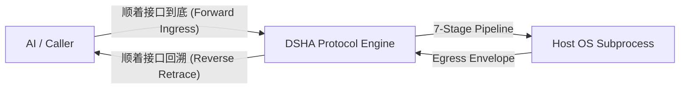
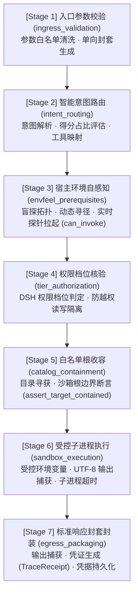

# DSHA 开放协议规范 (DSHA Open Protocol Specification)

**协议版本**: `v1.2.0-std`  
**状态**: 项目接口规范（独立于V1.0发行；非外部标准认证）
**编目模式**: OpenRPC / JSON Schema 对齐  
**适用对象**: AI 智能体 (Antigravity, DeepSeek Harness, Claude, Cursor 等)、自动化调度流水线、宿主开发者工具  

---

## 目录

1. [协议架构与核心设计哲学](#1-协议架构与核心设计哲学)
2. [正向执行流水线：AI 顺着接口到底](#2-正向执行流水线ai-顺着接口到底)
3. [逆向审计与归因引擎：AI 顺着接口回溯](#3-逆向审计与归因引擎ai-顺着接口回溯)
4. [标准数据封套规范 (Schemas)](#4-标准数据封套规范-schemas)
5. [拒绝码与异常裁决矩阵](#5-拒绝码与异常裁决矩阵)
6. [AI 智能体无缝集成契约](#6-ai-智能体无缝集成契约)

---

## 1. 协议架构与核心设计哲学

DSHA 开放协议定义了 AI 智能体与真实操作系统运行环境之间的**双向确定性执行契约**。



### 五大核心契约准则

1. **零捆绑宿主探针原则 (No Bundled Runtimes)**:
   - DSHA 严禁向代码仓库内塞入臃肿的第三方运行时二进制文件；
   - 工具所需的基础环境（Python, Node.js, Wrangler, PowerShell 7, GNU Bash, Git）完全依托宿主环境感知（EnvFeel），通过实时动态寻径与轻量级进程探针拉起完成校验。
2. **极简单向传参封套 (Unidirectional Envelope)**:
   - 调用者仅向执行层传递严格白名单化的参数上下文（权限档位、超时、工作目录、明确环境变量）；
   - 杜绝父进程敏感凭证（Token/Secret）静默泄漏进子进程。
3. **白名单根收容隔离 (Target Containment)**:
   - 所有的启动脚本必须通过收容断言，严格落在合法根目录（仓库 `bin/` 或用户配置目录）内，拦截相对路径逃逸与非受信二进制拉起。
4. **前置失败拒绝与结构化反馈 (Fail-Closed & Structured Error)**:
   - 当前置依赖探测或权限裁决失败时，执行层应拒绝启动目标工具，并返回结构化拒绝块（`ErrBlock`）；依赖探测可能调用宿主进程且受探针超时设置影响，因此不承诺固定毫秒级拒绝时限。
5. **端到端双向溯源 (End-to-End Bidirectional Retraceability)**:
   - 任何一次执行均生成全局唯一的 `trace_id` 与执行凭据（`TraceReceipt`）；
   - 无论是执行成功还是被任何一层拦截阻断，调用方均可逆向回溯整条调用链，获取精准的阻断层级、根因证据、复现命令与回滚方案。

---

## 2. 正向执行流水线：AI 顺着接口到底

当 AI 智能体通过标准接口 `Call_Tools(tool_name, args, context)` 发起请求时，请求会严格依次流经以下 7 个标准生命周期阶段，直到操作系统内核拉起进程：



### 阶段执行断言标准

| 阶段编号 | 阶段标识 (`stage`) | 核心职责 | 阻断时的退出码 | 阻断生成的错误码 |
| :---: | :--- | :--- | :---: | :--- |
| **1** | `ingress_validation` | 校验调用者入参合法性，设置最大超时时间与工作路径 | 128 | `ERR_PROTOCOL_VIOLATION` |
| **2** | `intent_routing` | 分析自然语言或目标文件，输出得分占比（`score_share`）与命中依据 | 127 | `ERR_ROUTE_FAILED` |
| **3** | `envfeel_prerequisites` | 盲探宿主拓扑，探测依赖环境是否存在、版本是否满足并实测拉起验证 | 126 | `ERR_PREREQUISITE_MISSING` |
| **4** | `tier_authorization` | 读取当前活跃的 DSH 权限档位，拦截只读模式下的写操作或越权操作 | 126 | `ERR_PERMISSION_DENIED` |
| **5** | `catalog_containment` | 在目录中查找工具，校验解析目标是否完全落在受信沙箱根路径内 | 125 | `ERR_TARGET_OUTSIDE_SANDBOX` |
| **6** | `sandbox_execution` | 在受控环境中启动宿主子进程，按配置捕获输出并实施超时控制 | 124 / exit code | `ERR_EXECUTION_TIMEOUT` / non-zero |
| **7** | `egress_packaging` | 封装全量返回包（`DSHAResponse`），完成凭据签名与落盘保存 | 0 | 正常封签交付 |

**Stage 6 实现边界（兼容说明）**：`sandbox_execution` 是既有协议阶段标识，为保持 `TraceReceipt` 与外部调用兼容而保留该名称；它**不等于操作系统级沙箱**。当前 `BaseTool.execute()` 使用 `subprocess.run()` 在宿主系统启动进程，传入由 `ExecutionEnvelope` 生成的环境变量、工作目录与超时设置；`custom_env` 可显式增加变量，`capture=False` 时不捕获输出。Stage 5 的 `assert_target_contained()` 只校验启动目标（且允许 `PATH` 解析到的声明命令），不能限制该进程后续访问的文件、网络或子进程。当前执行路径未提供容器、命名空间、文件系统或网络隔离，也不保证超时后终止完整后代进程树。若用于不可信代码或自博弈训练，必须额外配置并验证独立的 OS 级隔离与资源限制。

---

## 3. 逆向审计与归因引擎：AI 顺着接口回溯

在执行链条的任何环节发生阻断、崩溃或异常时，AI 智能体可以**顺着接口回溯**，调用逆向回溯引擎：

```python
from base_tool import retrace
report = retrace(response_or_trace_id)
print(report)
```

或通过终端命令行：
```bash
dsha retrace <trace_id>
dsha-index retrace <trace_id>
```

### 逆向回溯遍历流 (Stage 7 → Stage 1)

回溯引擎以倒序对 7 大生命周期阶段进行因果溯源解构：

```
========================================================================
🔍 [DSHA 接口生命周期逆向回溯 · Retrace Engine v1.2.0-std]
========================================================================
  • 追踪标识 (Trace ID): tr_1729353912345_a1b2c3
  • 调用发起 (Caller):   ai-assistant
  • 目标工具 (Tool):     [WebEdge] Cloudflare Web & Edge Engine (id: cf)
  • 终态裁决 (Verdict):  REFUSED (退出码: 126, 总耗时: 18ms)
  • 宿主拓扑 (Topology): Windows 11 Enterprise AMD64 (nt)

⏪ 逆向调用链回溯 (Reverse Traversal: Stage 7 -> Stage 1):
  [7/7: 响应封套封装 (Egress Packaging)]     ✓ [PASS] (0ms)
      └─ 状态: Standard response envelope sealed with trace receipt
  [6/7: 沙箱子进程执行 (Sandbox Execution)]   ⊘ [SKIP] (因上游熔断拦截未下发)
  [5/7: 白名单根收容 (Catalog Containment)]  ⊘ [SKIP] (因上游熔断拦截未下发)
  [4/7: 权限档位核验 (Tier Authorization)]   ⊘ [SKIP] (因上游熔断拦截未下发)
  [3/7: 宿主环境自感知 (EnvFeel Prerequisites)] ❌ [FAIL] (18ms)
      └─ 状态: Host runtime prerequisite assertion failed
      └─ 证据: {"failed_prereqs": [{"binary": "wrangler", "detected_version": "missing", "required_version": "any"}]}
  [2/7: 意图路由匹配 (Intent Routing)]       ✓ [PASS] (0ms)
      └─ 状态: Direct tool identifier dispatch (bypass router)
  [1/7: 入口封套校验 (Ingress Validation)]   ✓ [PASS] (0ms)
      └─ 状态: Unidirectional execution envelope sanitized & bounds enforced

🎯 根因归因与证据链 (Root Cause & Forensic Evidence):
  • 阻断阶段: envfeel_prerequisites
  • 错误编码: ERR_PREREQUISITE_MISSING
  • 阻断原因: DSHA 拒绝执行: 工具 'cf' 缺少必需宿主运行环境，DSHA 坚持不臃肿合并运行时的纯净原则。
  • 修复建议:
      💡 Please install 'wrangler' via npm install -g wrangler and ensure it is available in PATH.

🔁 依契约复现命令 (L4 Reproducer):
  CLI:        dsha cf status
  PowerShell: powershell -Command "& dsha cf status"

↩️ 依契约回滚操作 (L4 Rollback):
  动作: no_side_effects
  命令: none
  安全: 安全无害
========================================================================
```

---

## 4. 标准数据封套规范 (Schemas)

### 4.1 请求封套 (`DSHARequest`)

```json
{
  "$schema": "http://json-schema.org/draft-07/schema#",
  "title": "DSHARequest",
  "type": "object",
  "required": ["tool"],
  "properties": {
    "trace_id": { "type": "string" },
    "caller": { "type": "string", "default": "ai-assistant" },
    "tool": { "type": "string", "description": "工具标识: cf | rea | scribe | pwsh | sh | tier | meter" },
    "args": { "type": "array", "items": { "type": "string" } },
    "context": {
      "type": "object",
      "properties": {
        "tier": { "type": "string", "enum": ["read-only", "workspace-write", "danger-full-access", "auto"] },
        "timeout": { "type": "integer", "minimum": 1, "maximum": 3600 },
        "cwd": { "type": "string" },
        "proxy": { "type": "string" },
        "capture": { "type": "boolean", "default": true },
        "custom_env": { "type": "object" }
      }
    }
  }
}
```

### 4.2 响应封套 (`DSHAResponse`)

```json
{
  "$schema": "http://json-schema.org/draft-07/schema#",
  "title": "DSHAResponse",
  "type": "object",
  "required": ["protocol", "trace_id", "success", "exit_code", "duration_ms", "envfeel", "trace_receipt"],
  "properties": {
    "protocol": { "type": "string", "const": "dsha-1.2.0-std" },
    "trace_id": { "type": "string" },
    "success": { "type": "boolean" },
    "tool": { "type": "string" },
    "tool_name": { "type": "string" },
    "category": { "type": "string" },
    "exit_code": { "type": "integer" },
    "stdout": { "type": "string" },
    "stderr": { "type": "string" },
    "duration_ms": { "type": "integer" },
    "err_block": { "type": ["object", "null"] },
    "envfeel": {
      "type": "object",
      "properties": {
        "status": { "type": "string" },
        "platform": { "type": "string" },
        "reason": { "type": "string" },
        "tier": { "type": "string" },
        "cwd": { "type": "string" }
      }
    },
    "trace_receipt": { "type": "object" }
  }
}
```

---

## 5. 拒绝码与异常裁决矩阵

| 错误编码 (`error_code`) | 退出码 | 发生阶段 | 触发原因 | 处理与修复指引 |
| :--- | :---: | :--- | :--- | :--- |
| `ERR_PREREQUISITE_MISSING` | 126 | Stage 3 | 工具声明的运行环境在宿主未寻获或实测探针无法拉起 | 按照回溯报告中的 `remediations` 提示在宿主安装该工具链 |
| `ERR_PERMISSION_DENIED` | 126 | Stage 4 | 当前处于 `read-only` 只读档位，而请求工具具有写操作风险 | 运行 `agy-tier.ps1 <tier>` 切换为 `workspace-write` 或 `auto` |
| `ERR_TARGET_OUTSIDE_SANDBOX` | 125 | Stage 5 | 解析出的启动目标落在仓库 `bin/` 与受信配置目录之外 | 检查 DSHA-Index 映射配置，严禁使用相对路径逃逸沙箱 |
| `ERR_EXECUTION_TIMEOUT` | 124 | Stage 6 | 外部进程运行超过设定的安全阈值（默认 180s） | 检查目标进程是否发生死锁或网络假死，必要时调大 `timeout` |
| `ERR_LAUNCHER_NOT_FOUND` | 127 | Stage 5 | 启动器脚本文件在磁盘上丢失 | 重新运行 `install.ps1` 修复 DSHA 环境 |
| `ERR_SUBPROCESS_EXIT_NONZERO` | 1..255 | Stage 6 | 操作系统进程自身报错返回非 0 状态 | 查阅 `stderr` 输出并通过 `retrace` 获取复现命令现场调试 |

---

## 6. AI 智能体无缝集成契约

AI 智能体可直接利用 DSHA 标准契约完成自主调用与容错自愈：

```python
from scripts.index import Call_Tools
from scripts.base_tool import retrace

# 1. 顺着接口到底：下发标准调用
res = Call_Tools("cf", ["status"], {"tier": "auto", "timeout": 30})

# 2. 判断执行状态
if not res["success"]:
    # 3. 顺着接口回溯：直接逆向解构根因
    trace_analysis = retrace(res)
    print(trace_analysis)
    
    # 4. 根据回溯中的结构化证据链自愈
    failed_stage = res["trace_receipt"]["causal_chain"]["failed_stage"]
    remediations = res["trace_receipt"]["causal_chain"].get("remediations", [])
    # AI 可以根据 remediations 自动给出体检建议或引导用户排查
```
