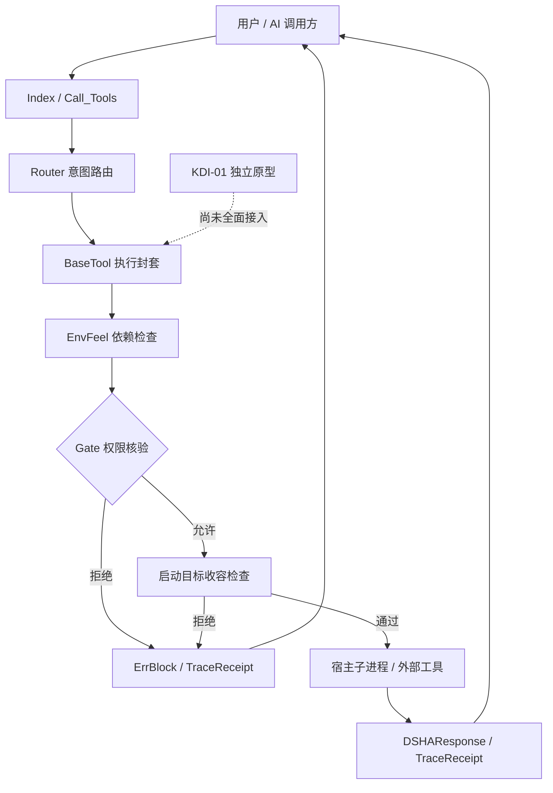
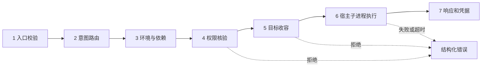
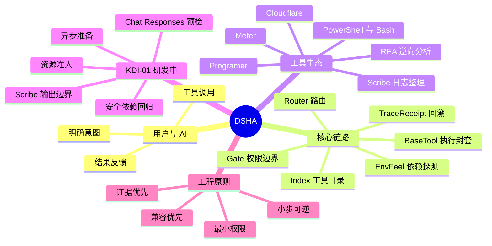

# DSHA-SharBoy V1.0

[](https://m8ven.ai/mcp/yanyu03-dsha-sharboy-15lh87?s=readme)
[](https://m8ven.ai/mcp/yanyu03/dsha-sharboy?s=readme)

> 欢迎收录、测试和反馈！请通过 [GitHub Issues](https://github.com/yanyu03/DSHA-SharBoy/issues) 提供可复现的问题与建议；我们会尽力持续完善 DSHA。


面向本地 AI 开发工作流的工具调度与工程记录套件。

**发行版本：V1.0** · 机器版本：`1.0.0` · 主要验证环境：Windows x64

[下载 V1.0](https://github.com/yanyu03/DSHA-SharBoy/releases/tag/V1.0) · [发行说明](docs/releases/V1.0.md) · [更新记录](CHANGELOG.md) · [MIT 许可证](LICENSE)

## 提供的功能

| 模块 | 用途与边界 |
| --- | --- |
| Gate | 本地权限档位及调用策略；不替代宿主权限或操作系统隔离 |
| EngLock | 工程报告、措辞和证据记录检查；不证明结论正确 |
| Meter | 根据可用宿主记录展示用量估计；以服务商官方额度为准 |
| Programer | 配置边界、输入契约、资源管理和验证指导；不分发课程全文 |
| Index / Router / BaseTool | 工具目录、依赖探测、路由、执行结果及收据；按声明条件检查 |
| Scribe | 本地日志整理和研究简报；收录范围需要明确配置 |
| REA 接入 | 对明确目标进行分析；工具、提供者和目标仍须单独验证 |

开放协议保留其独立标识 `v1.2.0-std`，这是本项目的接口规范版本，不是发行版本，也不表示外部标准组织认证。见[协议说明](DSHA_OPEN_PROTOCOL_SPEC.md)。

## 下载与安装

发行页提供 `DSHA-SharBoy-V1.0-source.zip`、`DSHA-SharBoy-V1.0-source.tar`、`SHA256SUMS.txt` 和 `SOURCE_MANIFEST.json`。ZIP 与 TAR 包含同一提交的源码，根目录统一为 `DSHA-SharBoy-V1.0/`。它们是源码分发包，不是独立可执行安装包。

解压后，先阅读[安装教程](安装教程.md)并预演：

```powershell
powershell -NoProfile -File .\install.ps1 -WhatIfOnly
```

确认目标目录、宿主及依赖后，可手动运行安装与检查：

```powershell
powershell -NoProfile -File .\install.ps1
powershell -NoProfile -File .\verify.ps1
```

运行脚本仍受本机执行策略限制。安装器、验证脚本可能写入本机配置；源码下载本身不会安装或修改环境。

## 环境与外部工具

- 第一方 Python 工具以 Python 3.10+ 为基础；部分 Codex 适配器工作流要求 Python 3.11+，以具体入口要求为准。
- REA 运行需要 Node.js；原生分析提供者可能另需 Java、Ghidra 等。
- PowerShell、Bash、Cloudflare 等按实际任务安装和配置。下载依赖、更新工具及远程服务可能需要网络。
- Codex 入口说明位于 `codex/skill/`；复制提示词或安装技能不自动授予本机工具、MCP 或更高权限。
- 工具被发现、版本探测成功、功能样本通过是不同证据。主分支不自动包含维护分支的所有修复。

## 验证与已知范围

本次发行只执行发行说明中列出的源码和包装检查。测试项数、跳过项和未测范围分别记录，不以旧报告或文件存在代替运行结果。Windows 以外环境、全新机器安装、真实账号服务及任意第三方项目不作通用可用性承诺。

版本与证据：[发行说明](docs/releases/V1.0.md)、[版本方案](VERSION_SCHEME.md)、[Programer 来源](docs/PROGRAMER_PROVENANCE.md)。

## 许可证与第三方

第一方代码按 [MIT](LICENSE) 提供；第三方文件保留其自身许可证。仓库含 REA 的 JavaScript 分发文件及包装器，不含本机 Node.js、Java、Ghidra、VS 或 Rust 安装环境。第三方来源、随附与外部调用的区别见 [NOTICE.md](NOTICE.md)。名称调整不授予第三方资料权利，也不删除 Git 历史。


## 架构与执行流程

DSHA 希望让 AI 通过明确的工具目录、参数契约、权限边界与回溯记录协作，而不是直接把宿主系统的全部权限交给模型。以下图示展示项目的核心职责与协议视图；不保证所有入口均已完整实现每个规范阶段。



### 七阶段生命周期（协议规范）



协议版本继续使用 [v1.2.0-std](DSHA_OPEN_PROTOCOL_SPEC.md)，独立于 V1.0 发行版本。第六阶段的历史标识为 `sandbox_execution`，**但当前不是操作系统级沙箱**；宿主子进程仍可在其 OS 权限范围内访问资源，Gate 与启动路径检查也不能代替容器、网络或文件系统隔离。

### 架构思维导图



## KDI-01 最新设计进度（FatFish 研发分支）

以下为已存在的**隔离原型**，不等于已发布或已全面接入正式执行链：

| 方向 | 代码位置 | 已实现的边界与限制 |
| --- | --- | --- |
| Chat / Responses 工具调用预检 | `scripts/kdi_protocol_preflight.py` | 解析完成的工具调用与可信字段映射；不执行工具，不是完整 SSE 适配器 |
| 异步准备和取消 | `scripts/kdi_preparation_gate.py` | Future 结果准入和取消标记；不能中止已开始执行的任务 |
| 资源配额 | `scripts/kdi_resource_admission.py` | 单实例内存租约；不是跨进程锁、OS 配额或权限授权 |
| Scribe 输出收容 | `scripts/kdi_scribe_output.py` | POSIX 托管输出实验，未接入正式 Scribe；不宣称 Windows 等效保护 |
| REA 依赖安全 | `skills/reverse-engineer-anything/tools/rea/package.json` | Zod 固定升级至 4.6.6，并有 `scripts/test_kdi_rea_dependency_security.py` 防回退测试；未验证所有用户安装环境 |

研发过程和待验证项见 [FatFish Draft PR #6](https://github.com/yanyu03/DSHA-SharBoy/pull/6)。计划继续研究可逆协议适配、调度与资源管理、确定性执行与回放、风险驱动验证、Windows/Linux 回归；**路线图不是功能承诺**。本 README 所述 FatFish 状态不代表 `main` 或 V1.0 发布包已经吸收这些更新。

## 设计理念

1. **AI 提出意图，执行层守住边界**：模型的建议不能替代权限、参数、目标路径和资源审查。
2. **契约优先，兼容优先**：保留 DSHARequest、DSHAResponse、TraceReceipt 与七阶段协议；新协议通过可逆适配逐步引入。
3. **默认拒绝不明确的输入**：未知字段、越权操作和不可核实的前置条件应给出可追溯的拒绝，而不是猜测执行。
4. **证据先于宣传**：区分静态检查、实际测试、CI、跨平台验证与正式发布；未运行的测试标记 SKIP。
5. **尊重第三方许可与事实边界**：REA 等第三方组件保留各自来源与许可证，不把工具可发现误写为完整可用。

## 欢迎收录、测试与反馈

欢迎工具目录、MCP 社区、研究者和开发者收录 DSHA，也欢迎测试、提出建议或参与改进。请在 [GitHub Issues](https://github.com/yanyu03/DSHA-SharBoy/issues) 提交安装故障、兼容性问题、协议建议、功能需求和文档勘误。欢迎 Pull Request，但请附改动范围和验证证据。

**建议 Issue 包含**：操作系统及版本、Python/Node 等相关运行时、DSHA 分支与 Commit、复现步骤、预期与实际结果、脱敏日志、已执行测试与结果。不要公开 API Key、Token、Cookie、个人数据或未授权的分析材料。涉及可利用的安全漏洞，优先使用仓库支持的私密安全报告渠道；如未启用，请先以不含漏洞细节的 Issue 请求安全联系方式。

上方 M8ven 徽章展示第三方平台的发布者验证信息，不等于全面安全认证，也不表示所有工具均通过独立动态测试。请以 [M8ven 项目页](https://m8ven.ai/mcp/yanyu03-dsha-sharboy-15lh87?s=readme) 展示的具体扫描范围为准。

> DSHA 仍在持续打磨。我们希望它成为一套可理解、可检查、可复现、可持续改进的 AI 工具协作工程。感谢每位愿意试用、指出问题和分享经验的朋友；我们会尽力让各位获得更可靠、更清晰的使用体验。
